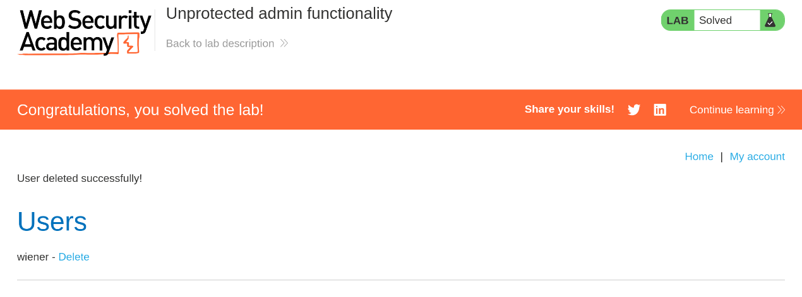

# Lab 01 — Unprotected Admin Functionality

| Field | Value |
|---|---|
| Platform | [PortSwigger Web Security Academy](https://portswigger.net/web-security/access-control/lab-unprotected-admin-functionality) |
| Category | Broken access control — unauthorised administrative actions |
| Lab status | **Solved** (19 October 2026) |
| Environment | Intentionally vulnerable, authorised educational lab |
| Assistance / hints | **Not yet confirmed** |

## Objective and scope

Assess whether administrative functionality in the designated PortSwigger training environment is correctly restricted to authorised users. This exercise was conducted only within the lab.

## My approach

I inspected the site's publicly accessible `robots.txt` file and noticed an administrative location. I then navigated to that location directly and found that the lab exposed administrative functionality without requiring me to authenticate. Within the authorised exercise, I was able to perform the required account-deletion action.

## Finding: Missing server-side access control

**Observation:** An unauthenticated browser session could reach the administrative interface and invoke a privileged function. The lab confirmed successful completion after the action.

**Root cause:** The application failed to enforce an effective server-side authentication and authorisation check for administrative functionality. The path's appearance in `robots.txt` made it easier to discover, but discoverability alone was **not** the security vulnerability.

**Potential impact:** In an application with the same weakness, an unauthorised visitor could alter or delete accounts and perform other privileged actions, depending on the exposed functions.

## Evidence

*Evidence is cropped to exclude the unique training-lab URL and browser details. It shows completion, not every step of testing.*

## Recommended remediation

- Enforce authentication and administrator-role authorisation on the server for every privileged page and endpoint.
- Deny unauthorised actions even if someone knows the endpoint URL.
- Add regression tests confirming that unauthenticated and non-administrator requests cannot invoke privileged functions.

## What I learned

A sensitive URL being hidden or listed as disallowed in `robots.txt` is not access control. Security decisions must be enforced on the server, not by relying on secrecy of paths or the presence of a login-page link.

## Limitations and reflection

This was an educational lab, not a client penetration test. The screenshot corroborates lab completion, and the methodology above is my own account of the exercise. My degree of independence will be recorded after I confirm whether I used hints or external solutions.
